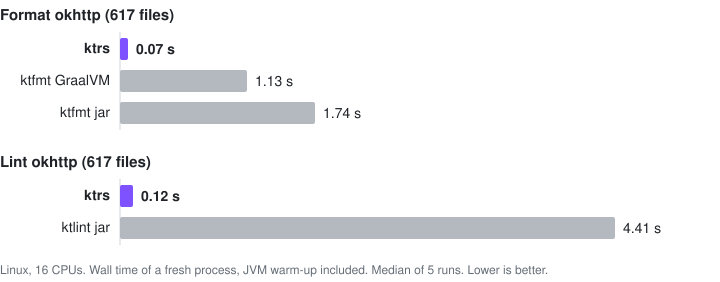

<div align="center">

# ktrs

**Kotlin formatting and linting in Rust, without starting a JVM.**

[](https://github.com/Hexay/ktrs/actions/workflows/ci.yml)
[](https://crates.io/crates/ktrs)
[](#license)
[](https://hexay.github.io/ktrs/)



</div>

ktrs is a native replacement for [ktfmt](https://github.com/facebook/ktfmt) and
[ktlint](https://github.com/pinterest/ktlint). It produces the same output and ships as small binaries
with no runtime. Try the formatter in the **[playground](https://hexay.github.io/ktrs/)**, which runs it
as WebAssembly.

- ⚡ **Fast.** 10-200x faster than the jars and 2-16x faster than ktfmt's GraalVM native image
  ([Performance](#performance)).
- 🎯 **Identical output.** Byte-identical to ktfmt 0.65 on 6,121 of 6,123 real-world files (both
  tools reject the other two). Lint violations and `--format` output match ktlint 2.0 in all three
  code styles, and ktlint 1.8 in a compatibility mode ([How we test](#how-we-test)).
- 🔌 **Drop-in.** The `ktfmt` and `ktlint` binaries accept the originals' flags, messages and exit
  codes, so existing scripts, hooks and CI keep working.
- 🧩 **Fits your setup.** [GitHub Actions](#github-actions), [pre-commit](#pre-commit),
  [editors](#editors), [Gradle](#gradle), [Maven](#maven),
  [Bazel, reviewdog and Danger](docs/ci-integrations.md).
- 🌳 **Built on a faithful parser.** The lossless Kotlin parser's tree matches the compiler's PSI node
  for node, and [you can use it as a library](#use-the-parser-as-a-library).

## Installation

```sh
curl -fsSL https://raw.githubusercontent.com/Hexay/ktrs/master/install.sh | sh   # prebuilt binaries
cargo binstall ktrs                                                               # prebuilt, via cargo-binstall
cargo install ktrs                                                                # from crates.io
brew tap hexay/ktrs https://github.com/Hexay/ktrs && brew install hexay/ktrs/ktrs  # Homebrew
scoop bucket add ktrs https://github.com/Hexay/ktrs && scoop install ktrs/ktrs     # Scoop (Windows)
npm install --save-dev @ktrs/cli                                                  # npm (npx ktlint, npx ktfmt)
docker run --rm -v "$PWD:/src" ghcr.io/hexay/ktrs ktlint "**/*.kt"                 # Docker (linux amd64/arm64)
```

One install puts three binaries on your PATH: `ktrs`, `ktfmt` and `ktlint`. On Windows, the
install script also works under Git Bash, or download a zip from
[Releases](https://github.com/Hexay/ktrs/releases). The Docker image takes the binary name as its first argument,
works in `/src`, and has no Java, so `ktlint -R` with a rule set other than compose-rules doesn't run there; on
Linux, add `--user "$(id -u):$(id -g)"` to keep fixed files owned by you.

## Usage

```sh
ktrs fmt                              # format every .kt/.kts under the current directory
ktrs fmt --style kotlinlang src/      # styles: meta (default), google, kotlinlang
ktrs fmt --check                      # CI: list files that would change, exit 1 if any
ktrs fmt --changed-since main         # only files changed since the merge base with main
ktrs fmt - < Foo.kt                   # stdin to stdout, for editors

ktrs lint                             # check every .kt/.kts under the current directory
ktrs lint --format src/               # autocorrect what can be fixed, report the rest
ktrs lint --changed-since main        # only files changed since the merge base with main
ktrs lint --reporter json - < Foo.kt  # reporters: plain, json, checkstyle, sarif, html, ...
```

### Drop-in for ktfmt and ktlint

The `ktfmt` and `ktlint` binaries accept the original command lines exactly, so anything that runs
the jars can run them instead:

```sh
ktfmt --kotlinlang-style --set-exit-if-changed src/
ktlint --relative "src/**/*.kt" "!src/**/generated/**"
```

- `ktfmt` supports all of ktfmt's flags, plus `@argfile`, `-` for stdin and `--enable-editorconfig`.
- `ktlint` supports `!` negation in patterns, `-F`, `--stdin`, `--patterns-from-stdin`, `--baseline`,
  `--editorconfig`, every built-in reporter, and the git hook subcommands.
- ktlint implements 2.0.0-ALPHA-4, with its engine and all 105 standard rules.

**ktlint 1.8.** Most teams still run ktlint 1.x, and 2.0 changed rule results, autocorrect order,
exit codes and baseline matching ([research/22](research/22-ktlint-1x-gap.md)). To get 1.8.0
behaviour, add this to `.editorconfig` (the ktlint jars ignore it), or pass `--ktlint-version=1.8`:

```ini
[*.{kt,kts}]
ktrs_ktlint_version = 1.8
```

This mode ports 1.8's rule differences, its rule-by-rule autocorrect order and its CLI. On 21,000
files it matches the 1.8.0 jar except for a few KDoc whitespace rows, where 1.8's older Kotlin lexer
splits trailing spaces differently ([research/26](research/26-ktlint-18-mode.md)).

**Custom rule sets.** `-R` jars are supported, in `ktlint` and `ktrs lint`.
[compose-rules](https://github.com/mrmans0n/compose-rules) 0.6.8, by far the most used rule set,
runs natively with output identical to the jar (the `-all.jar` and the Maven artifacts). Any other
rule set or reporter jar hands the whole run to the real ktlint jar (downloaded once and checked by
SHA-256; needs Java), so it works at JVM speed ([research/27](research/27-custom-rulesets-impl.md)).

**ktfmt version.** ktrs formats exactly like ktfmt 0.65, everywhere: the binaries, the Gradle and
Maven integrations and the editor support. Tools that bundle an older ktfmt (ktfmt-gradle 0.27.0 and
Spotless's default are on 0.64) therefore format slightly differently from ktrs: switching to ktrs
shows the same one-time diff as upgrading ktfmt to 0.65 (for example, a trailing comma after a single
argument that sits on its own line).

**Limits.**

- The `ktfmt` binary parses with Kotlin 2.4.21's grammar; ktfmt 0.65 is built on Kotlin 2.4.10, so
  syntax newer than that is accepted here and rejected there.
- ktfmt's undocumented `--experimental-engine` flag is rejected.

## Performance

Each tool runs from the command line with the same flags and files. Times are the median wall time of 5
runs of a **fresh process**, on one Linux machine (Ryzen 7 9700X, 16 CPUs, JDK 21).

**JVM warm-up is included.** Every run starts a new JVM, so jar times include startup, class loading and
a cold JIT, which is what a CLI, hook or CI step pays. The last table shows the jars fully warmed up.

ktfmt is compared as both the jar and its official GraalVM native image, the binary ktfmt publishes with each release:

| ktfmt 0.65 | ktrs | GraalVM | Jar | vs GraalVM | vs jar |
|---|--:|--:|--:|--:|--:|
| Editor: one 8 KB file on stdin | <5 ms | 7.1 ms | 376 ms | **~5x** | **>70x** |
| Pre-commit: 10 changed files | <5 ms | 6.4 ms | 365 ms | **~2x** | **>70x** |
| Format okhttp (617 files) | 73 ms | 1.13 s | 1.74 s | **16x** | **24x** |
| Format okhttp, 1 core | 250 ms | 2.48 s | 6.81 s | **10x** | **27x** |
| Format 7 projects (6,123 files) | 298 ms | 4.68 s | 4.70 s | **16x** | **16x** |

| ktlint | ktrs | Jar | vs jar |
|---|--:|--:|--:|
| 2.0: lint one file | <5 ms | 402 ms | **>80x** |
| 2.0: lint okhttp | 119 ms | 4.41 s | **37x** |
| 2.0: lint 7 projects | 640 ms | 19.65 s | **31x** |
| 2.0: autocorrect okhttp (`-F`) | 219 ms | 42.73 s | **195x** |
| 1.8 mode: lint okhttp | 220 ms | 3.25 s | **15x** |
| 1.8 mode: lint 7 projects | 1.29 s | 13.05 s | **10x** |

ktlint has no GraalVM column because its 2.0.0-ALPHA-4 Linux native image crashes on every lint or format.

| Jars warmed up, okhttp | ktrs | Jar, fresh process | Jar, warmed up | vs warmed up |
|---|--:|--:|--:|--:|
| Format | 73 ms | 1.74 s | 276 ms | **4x** |
| Lint (2.0) | 119 ms | 4.41 s | 2.96 s | **25x** |

"Warmed up" is the median of the last 5 of 30 runs inside one JVM. Command-line users never get this; a
long-lived process can approach it.

Every scenario, memory use, Spotless numbers, the method and how to reproduce it all:
**[docs/performance.md](docs/performance.md)**.

## How we test

Parity with the original tools is the spec: ktrs runs next to the real jars, and a difference fails the gate unless
it is on a reviewed list in [`tools/parity/known-diffs/`](tools/parity/known-diffs/). A release can't be tagged
without a passing parity run on its commit.

| What | Compared with | On | When |
|---|---|---|---|
| Unit and ported upstream tests (ktfmt's suite, ktlint's rule tests) | Upstream's expected results | Linux, macOS, Windows | Every push and PR |
| Parser | Kotlin compiler's PSI tree (`DebugUtil.psiToString`) | Compiler's fixtures, every corpus file | Fixtures every push, corpus nightly |
| Formatter | ktfmt jar, byte for byte | Corpus in meta, google and kotlinlang styles | Nightly |
| Linter | ktlint jar: violations and `--format` output | Corpus in `ktlint_official`, `intellij_idea`, `android_studio`, with and without experimental rules | Nightly |
| ktlint 1.8 mode, compose-rules | Their jars | Corpus | Nightly |
| CLIs | Jars: stdout, stderr, exit code, written files | Scenario suite, including editor invocations | Nightly |
| Gradle and Maven drop-ins | The original plugins | Fixture builds | Nightly |
| Held-out corpus | Same as the formatter, linter and CLIs | 15,287 files from 20 other projects, which never drove a fix | On demand |
| Fuzzing | Jars, plus crash and hang checks | Mutated real-world files | On demand |

The **corpus** is ~6,000 files from 7 projects, pinned in [`tools/corpus/REVISIONS`](tools/corpus/REVISIONS). The
[nightly parity run](https://github.com/Hexay/ktrs/actions/workflows/parity.yml) is public, and a weekly workflow opens
an issue when ktfmt, ktlint, compose-rules or Kotlin publishes a newer release.

- **Held-out corpus.** It checks that corpus work didn't overfit. In its first run, all 2.2M lint violations and
  every ktfmt output matched in all three styles, and `--format` differed on 3 files from one rule, since fixed
  ([research/21](research/21-holdout.md); `tools/holdout/run.sh`).
- **Fuzzing.** The first runs found 4 bugs, now fixed, including exponential parser memory on deeply nested
  generic-looking input ([research/24](research/24-fuzzing.md); `fuzz/`, `tools/fuzz/diff.sh`).

Run them yourself: `cargo test`, then `cargo corpus-diff`, `cargo fmt-diff` and `cargo lint-diff`. The full list of
gates is in [`CLAUDE.md`](CLAUDE.md).

## Integrations

### Migrating

`ktrs migrate` switches a build's ktfmt-gradle, ktlint-gradle, kotlinter, ktlint-maven-plugin and
Spotless setup to the ktrs drop-ins described below, editing only ids, coordinates and versions in
place. Setups it can't rewrite, such as a task that runs ktlint from its jar, get a `note:` saying
what to change by hand.

```sh
ktrs migrate            # print the edits as a diff; exit 1 if there are any
ktrs migrate --write    # apply them
```

### GitHub Actions

Check a pull request's Kotlin files, with each finding shown as an annotation on the diff:

```yaml
- uses: actions/checkout@v4
  with: { fetch-depth: 0 }         # changed-only needs the history back to the base commit
- uses: Hexay/ktrs@v0.5.3          # Linux, macOS and Windows
  with:
    check: fmt lint                # ktrs fmt --check and ktrs lint (or just one of them)
    changed-only: true             # only the files the pull request changes
    fmt-args: --style kotlinlang   # lint-args likewise
```

`sarif: true` also uploads the lint findings to GitHub code scanning, so they show up in the Security tab and
stay tracked across commits, without the annotation limit. The job needs `permissions: { contents: read,
security-events: write }`, and private repositories need GitHub Code Security:

```yaml
- uses: Hexay/ktrs@v0.5.3
  with:
    check: lint
    sarif: true                    # sarif-category: <name> keeps several uploads apart
```

`changed-only` compares with the pull request's base commit. On a push it compares with the commit
before the push, or with the default branch for a new branch or a force push; `base: <ref>` overrides
this. Without `check`, the action only installs the binaries, and you run them yourself:

```yaml
- uses: Hexay/ktrs@v0.5.3
- run: ktrs fmt --check --style kotlinlang
- run: ktrs lint --reporter github --changed-since origin/main
```

`--changed-since <ref>` (`ktrs fmt` and `ktrs lint`) keeps the files that differ from the merge base
of `<ref>` and `HEAD`, including uncommitted and untracked ones. `--reporter github` (`ktrs lint` and
`ktrs fmt --check`) prints the findings as annotations. GitHub shows at most 10 annotations per step;
the job log has all of them.

### pre-commit

No Rust needed: on first run, the hook downloads the release binaries for its `rev`.

```yaml
- repo: https://github.com/Hexay/ktrs
  rev: v0.5.3
  hooks:
    - id: ktrs-fmt          # also: ktrs-fmt-check, ktfmt (with ktfmt's flags in `args`)
      args: [--style, kotlinlang]
    - id: ktrs-lint         # also: ktrs-lint-format, ktlint (with ktlint's flags in `args`)
```

### Editors

`ktrs lsp` is a language server for ktlint diagnostics, quick fixes and ktfmt or ktlint formatting.
It runs next to your Kotlin language server and takes its setup from the Gradle or Maven build.

- **VS Code:** install the `hexay.ktrs` extension, which bundles it.
- **IntelliJ IDEA 2025.3+ and Android Studio:** install the `ktrs` plugin (`io.github.hexay.ktrs`, also
  bundling it; the IDEs without the platform LSP client need LSP4IJ), or the release's
  `ktrs-intellij-<version>.zip` from disk.
- **Plugins that already run `ktlint` or `ktfmt`** (conform.nvim, nvim-lint, none-ls, ALE, apheleia,
  flycheck-kotlin, Helix, Zed, VS Code's mskelton.ktlint, Block's IntelliJ Kotlin Formatter) work unchanged
  with the drop-in binaries; their exact invocations are diffed against the jars.

Configs for all of these: [docs/editors.md](docs/editors.md).

### Gradle

**ktfmt-gradle drop-in.** The `io.github.hexay.ktrs` plugin replaces
[ktfmt-gradle](https://github.com/cortinico/ktfmt-gradle) 0.27.0. Change only the plugin id. The
`ktfmt { }` block, the `ktfmtCheck`/`ktfmtFormat*` tasks, `--include-only` and the
`com.ncorti.ktfmt.gradle.*` imports keep working. Formatting is ktfmt 0.65's; ktfmt-gradle 0.27.0
bundles ktfmt 0.64, so the first `ktfmtFormat` after the switch is the ktfmt 0.64 to 0.65 diff.

```kotlin
plugins {
    id("io.github.hexay.ktrs") version "0.5.3"   // was: id("com.ncorti.ktfmt.gradle") version "0.27.0"
}
```

**ktlint-gradle drop-in.** The `io.github.hexay.ktrs.ktlint` plugin replaces
[ktlint-gradle](https://github.com/JLLeitschuh/ktlint-gradle) 14.2.0 the same way: the `ktlint { }`
block, `ktlintCheck`/`ktlintFormat` and the per-source-set, baseline and git hook tasks,
`ktlintRuleset(...)` and the `org.jlleitschuh.gradle.ktlint.*` types keep working. Console output,
reports and formatted files match the original with ktlint 1.8.0
([research/29](research/29-ktlint-gradle-dropin.md)).

```kotlin
plugins {
    id("io.github.hexay.ktrs.ktlint") version "0.5.3"   // was: id("org.jlleitschuh.gradle.ktlint") version "14.2.0"
}
```

`version` defaults to `"1.8.0"`; `"2.0.0-ALPHA-4"` selects 2.0, and other versions fail the build.
compose-rules runs natively; other rule sets run the task through the real ktlint jar.

**kotlinter drop-in.** The `io.github.hexay.ktrs.kotlinter` plugin replaces
[kotlinter](https://github.com/jeremymailen/kotlinter-gradle) 5.7.0: the `kotlinter { }` block,
`lintKotlin`/`formatKotlin` and the per-source-set tasks, `installKotlinterPrePushHook`,
`ktlint(...)` rule sets and the `org.jmailen.gradle.kotlinter.*` types keep working
([research/34](research/34-kotlinter-dropin.md)).

```kotlin
plugins {
    id("io.github.hexay.ktrs.kotlinter") version "0.5.3"   // was: id("org.jmailen.kotlinter") version "5.7.0"
}
```

`ktlintVersion` defaults to `"1.8.0"`, as in kotlinter 5.7.0; versions and rule sets work as in the
ktlint-gradle drop-in.

**Spotless.** `KtrsStep` replaces `ktfmt()` and `KtrsKtlintStep` replaces `ktlint()` (Spotless 7+):

```kotlin
buildscript {
    repositories { mavenCentral() }
    dependencies { classpath("io.github.hexay:ktrs:0.5.3") }
}

spotless {
    kotlin {
        addStep(io.github.hexay.ktrs.spotless.KtrsStep.create(io.github.hexay.ktrs.KtrsOptions.kotlinlang()))
        // or, instead of ktlint("1.8.0").editorConfigOverride(...).customRuleSets(...):
        addStep(io.github.hexay.ktrs.spotless.KtrsKtlintStep.create(io.github.hexay.ktrs.KtlintOptions.defaults()
            .withEditorConfigPath(rootProject.file(".editorconfig"))
            .withEditorConfigOverride(mapOf("ktlint_code_style" to "ktlint_official"))))
    }
}
```

`KtrsKtlintStep` gives the same results as Spotless's `ktlint("1.8.0")` step
([research/28](research/28-spotless-ktlint-step.md)). `withCustomRuleSets(files)` takes jar files;
only compose-rules is supported there, other rule sets need Spotless's `ktlint()`.

<details>
<summary>JVM API and options</summary>

The `io.github.hexay:ktrs` jar has no dependencies. It bundles the native binaries for Linux, macOS
and Windows (x86-64 and ARM) and keeps long-lived `ktrs serve` processes, so a build starts the
binary once, not once per file.

- `KtrsOptions` mirrors ktfmt's options: start from `meta()`, `google()` or `kotlinlang()`, then
  chain `withMaxWidth`, `withBlockIndent`, `withContinuationIndent`, `withRemoveUnusedImports`,
  `withTrailingCommas` and `withEditorConfig(true)`.
- From other JVM code, `Ktrs.create()` returns a thread-safe formatter:
  `ktrs.format(code, KtrsOptions.google())`, or `ktrs.ktlint(code, KtlintOptions.defaults(), path)`
  for ktlint's formatted code and remaining violations.
- The plugin accepts `useClassloaderIsolation`, `processIsolationJvmArgs` and `ktfmtClasspath` but
  ignores them. `debuggingPrintOpsAfterFormatting` only logs a warning.
- To use a different binary from the bundled one, set the Gradle property `ktrs.executable`.
- Without the jar, Spotless's generic step runs the binary once per file:
  `nativeCmd("ktfmt", "/path/to/ktfmt", listOf("--kotlinlang-style", "-"))`.

</details>

### Maven

**ktlint-maven-plugin drop-in.** `io.github.hexay:ktrs-ktlint-maven-plugin` replaces gantsign's
[ktlint-maven-plugin](https://github.com/gantsign/ktlint-maven-plugin) 3.7.1. Change only the
coordinates: the goals (`mvn ktlint:check`, `ktlint:format`, the `ktlint` site report), parameters,
`ktlint.*` properties, `<reporters>` and rule sets in the plugin's `<dependencies>` keep working, and
console output, reports and formatted files match the original
([research/31](research/31-ktlint-maven-dropin.md)).

```xml
<plugin>
  <groupId>io.github.hexay</groupId>                   <!-- was: com.github.gantsign.maven -->
  <artifactId>ktrs-ktlint-maven-plugin</artifactId>    <!-- was: ktlint-maven-plugin -->
  <version>0.5.3</version>
  <executions><execution><goals><goal>check</goal></goals></execution></executions>
</plugin>
```

`<ktlintVersion>` (property `ktrs.ktlintVersion`) defaults to `1.8.0`; `2.0.0-ALPHA-4` selects 2.0.

**Spotless.** Add `implementation=` to the existing `<ktfmt>` or `<ktlint>` element and the jar as a
plugin dependency; the other options stay as they are (Maven 3.9+, Java 17+):

```xml
<plugin>
  <groupId>com.diffplug.spotless</groupId>
  <artifactId>spotless-maven-plugin</artifactId>
  <configuration>
    <kotlin>
      <ktfmt implementation="io.github.hexay.ktrs.spotless.maven.KtrsKtfmt"><style>KOTLINLANG</style></ktfmt>
      <!-- or <ktlint implementation="io.github.hexay.ktrs.spotless.maven.KtrsKtlint">…</ktlint> -->
    </kotlin>
  </configuration>
  <dependencies>
    <dependency><groupId>io.github.hexay</groupId><artifactId>ktrs</artifactId><version>0.5.3</version></dependency>
  </dependencies>
</plugin>
```

Output is that of ktfmt 0.65 and identical to stock `<ktlint>` 1.8.0 (`tools/spotless-maven/parity.sh`).
`<version>` must be left out or match (ktfmt `0.65`; ktlint `1.8.0` or `2.0.0-ALPHA-4`). Stock
`<ktfmt>` without a `<version>` runs Spotless's default, 0.64: the swap then also is the upgrade to 0.65.

### Bazel, reviewdog and Danger

The binaries work with [rules_lint](https://github.com/aspect-build/rules_lint),
[reviewdog](https://github.com/reviewdog/reviewdog) and [Danger](https://danger.systems) plugins. Setup:
[docs/ci-integrations.md](docs/ci-integrations.md).

## Use the parser as a library

The parser is available on its own as the Rust crate [`kt-syntax`](crates/kt-syntax): a parser for
Kotlin that builds the compiler's PSI tree (same kinds, same nesting, same error elements) with no JVM.
It gives you navigation, byte ranges and line/column positions, syntax errors as nodes, comments and
parsed KDoc, and text edits for codemods.

```rust
use kt_syntax::{SyntaxKind, parse};

let file = parse("fun old() = 1\nval x = old()\n").unwrap();
for function in file.root().find_all(&[SyntaxKind::FUN]) {
    let name = function.child(SyntaxKind::IDENTIFIER).unwrap();
    println!("{} at {:?}, documented: {}", name.text(), name.range(), function.doc_comment().is_some());
}

// Edits are text edits: collect them, apply them, get the new source.
let calls = file.root().find_all(&[SyntaxKind::CALL_EXPRESSION]);
let edits = calls.filter_map(|call| call.first_child()).map(|callee| callee.replace("new"));
assert_eq!(file.apply_edits(edits).unwrap(), "fun old() = 1\nval x = new()\n");
```

`kt-syntax` is the stable API. The `ktrs-*` crates on crates.io are the internals of this repository
and can change in any release. More in the crate's [README](crates/kt-syntax/README.md), with two
runnable examples: a lint (`examples/missing_kdoc.rs`) and a codemod (`examples/rename_call.rs`).

## Maintenance

ktrs is maintained by [@Hexay](https://github.com/Hexay). It tracks ktfmt 0.65, ktlint
2.0.0-ALPHA-4 (plus 1.8.0 in compatibility mode), compose-rules 0.6.8 and the Kotlin 2.4.21 parser. New upstream
releases are ported and re-checked against the parity gates before a ktrs release. If ktrs output ever differs from
ktfmt or ktlint on your code, that's a bug: please [open an issue](https://github.com/Hexay/ktrs/issues) with the
file, or a snippet that reproduces it, and the command line you used.

## Contributing

```sh
tools/sync-kotlin.sh                  # pinned upstream sources + vendored test fixtures
tools/psi-dump/psi-dump.sh one X.kt   # reference PSI tree from the real compiler (needs a JDK)
cargo xtask codegen                   # regenerate SyntaxKind from crates/ktrs-syntax/kinds.tsv
cargo test
```

[`CLAUDE.md`](CLAUDE.md) lists the crate layout and every parity gate. Design notes are in
[`research/`](research/).

## License

Dual-licensed under [MIT](LICENSE-MIT) or [Apache-2.0](LICENSE-APACHE), at your option. ktrs
contains code and test data ported from the Kotlin compiler, the IntelliJ Platform, ktfmt,
google-java-format, ec4j (Apache-2.0), ktlint and ktfmt-gradle (MIT). See [NOTICE](NOTICE).
